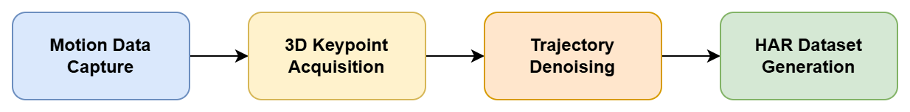
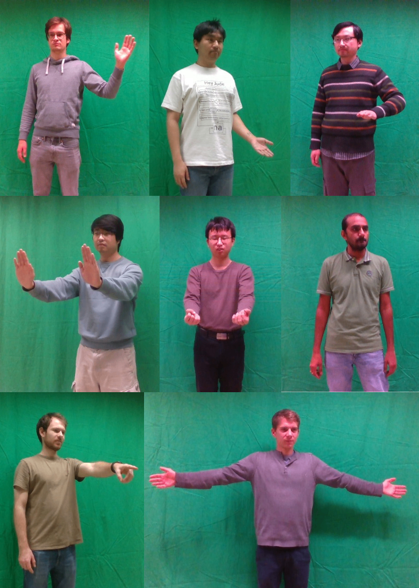
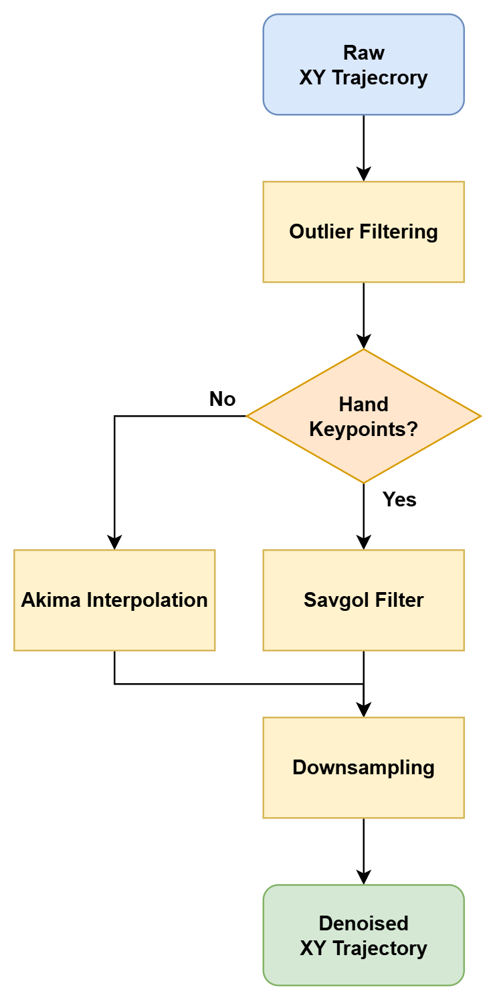
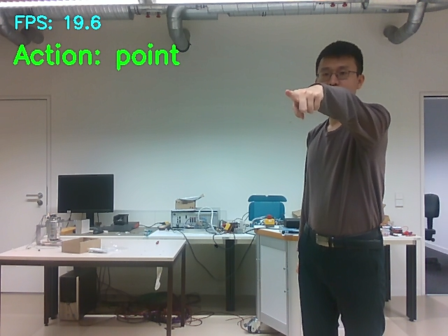

# RGB-D Skeleton-Based Human Action Recognition

[English](README.md) | [简体中文](README.zh-CN.md)

> A lightweight RGB-D pipeline for markerless 3D skeleton-based human action recognition and real-time inference.

## Overview

This project explores how a low-cost RGB-D camera can be used to build a 3D human action recognition dataset for human-robot interaction scenarios.

The pipeline combines RGB-D capture, human pose estimation, 2D-to-3D lifting, trajectory denoising, sliding-window dataset generation, and skeleton-based action recognition.

## Pipeline

1. **Motion data capture** with Intel RealSense D435 RGB-D cameras
2. **3D keypoint acquisition** by combining 2D human pose estimation with depth information
3. **Trajectory denoising** with separate strategies for the XY and Z dimensions
4. **Dataset generation** using a fixed-length sliding window
5. **Model evaluation** with PoseFormer and ST-GCN
6. **Real-time inference** under changes in viewpoint, lighting, distance, and partial occlusion

## Data Collection

- 9 participants
- 8 action and posture classes
- 1,264 captured motion sequences
- Upper-body skeleton representation
- Actions and postures include wave, lift, press, push, pull, pointing, stop, and background

## Method Highlights

### RGB-D 3D skeleton acquisition

RGB frames are processed with a human pose estimation model, and the detected 2D keypoints are lifted into 3D using depth values from the RGB-D camera.

### Dimension-specific trajectory denoising

The 3D trajectory is separated into XY and Z components. The project applies different processing strategies to account for their different noise characteristics.

### Sliding-window dataset generation

A window size of 48 frames and a stride of 16 frames generate fixed-length clips from the denoised trajectories. This increases data utilization and allows the model to recognize actions from arbitrary points in an ongoing motion.

## Results

- Approximately 3,000 generated clips across 8 classes
- Macro F1 score: **0.8987** with PoseFormer
- Macro F1 score: **0.8927** with ST-GCN
- XY hand trajectory stability improvement: up to **29.7%** for velocity and **53.3%** for acceleration
- Z trajectory stability improvement: **58.5%** for velocity and **65.2%** for acceleration on average

## Real-Time Inference

The skeleton-based representation remains usable under side views, poor lighting, increased subject-camera distance, and partial keypoint occlusion.

## Limitations and Future Work

The current setup is limited by depth sensing errors, occlusion, a limited number of action classes, and a relatively small number of participants. Future work includes multi-view reconstruction, improved denoising, and a larger and more diverse dataset.

## Project Materials

- [Research report](#)
- [Presentation slides](#)
- [Source code](#)

## Citation

If you use material from this project, please cite the accompanying research report.
