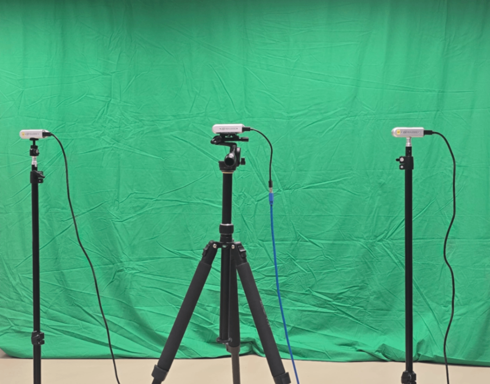
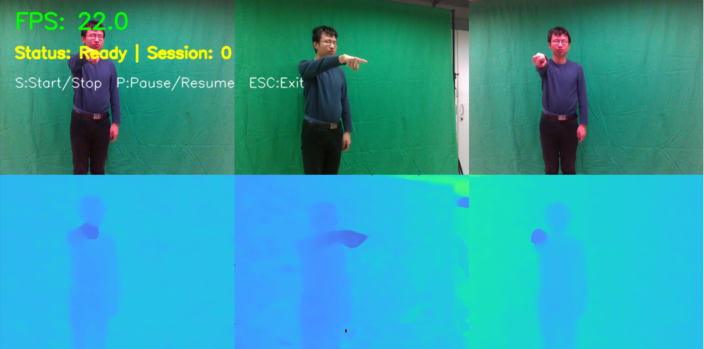
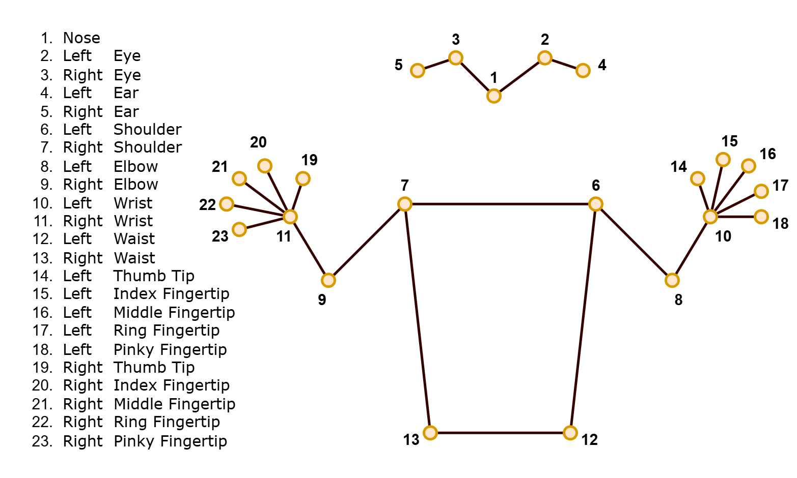
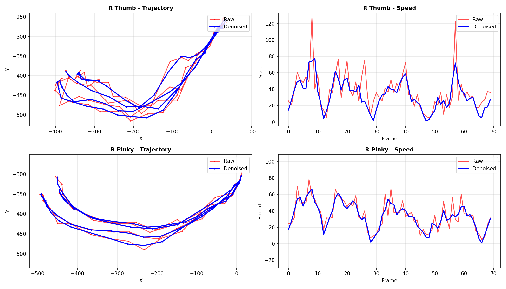
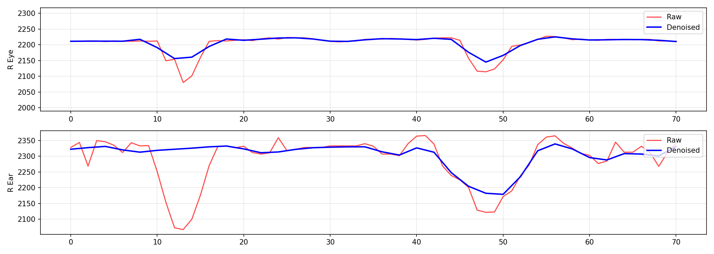
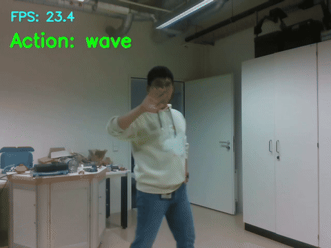
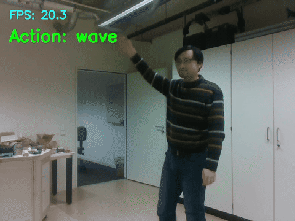
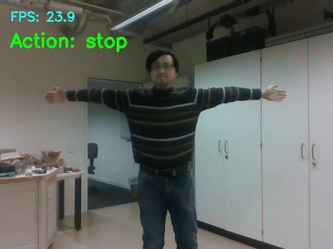
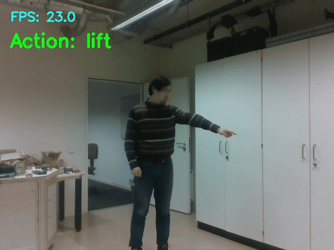

# 基于 RGB-D 的三维骨骼动作数据集构建与实时识别

[English](README.md) | [简体中文](README.zh-CN.md)

> 从 RGB-D 动作采集到三维骨骼数据集构建，并通过动作识别模型和在线推理验证数据的可用性。

**邹松华 · Research Internship · 开姆尼茨工业大学（TU Chemnitz）**

## 项目概览

面向近距离人机交互中的上半身动作与手势，本项目使用 Intel RealSense D435 采集 RGB 和深度数据，结合人体姿态估计获取三维骨骼轨迹，再经过轨迹去噪与片段整理，构建可用于动作识别训练的数据集。深度信息直接用于恢复空间坐标，减少了对标记式动捕设备和多视角几何重建的依赖。

**我的工作：**独立执行项目，完成采集流程搭建与参与者采集组织、关键点方案评估、三维轨迹处理、数据集生成，以及模型训练和在线推理验证。姿态提取使用现有的 RTMW 模型，识别验证基于 PoseFormer 和 ST-GCN。

## 数据采集：记录面向交互的动作

组织 9 名参与者录制动作，在实验中布置三台 RGB-D 相机，从不同视角记录 RGB 图像与深度信息。后续利用各视角的深度数据获取三维坐标；这里的多视角采集不等同于多相机融合重建。

*采集设备布置。*

*采集界面：上方为 RGB 图像，下方为对应深度画面，支持录制启停和暂停。*

| 采集内容 | 规模与组成 |
| --- | --- |
| 参与者 | 9 人 |
| 原始动作序列 | 1,264 条 |
| 动态动作 | 挥手、抬起、按压、推动、拉动 |
| 静态姿态 | 指向、停止 |
| 背景类 | 自然站立及与交互无关的小幅动作 |

*依次为挥手、抬起、按压、推动、拉动、背景、指向、停止。*

## 骨骼提取：从 RGB-D 到三维轨迹

为选择适合本场景的姿态估计方案，我构建了约 600 张人工校正、带关键点可见性标注的图像评估集，对比 5 种模型组合，最终选用 RTMW。

从预测结果中保留 23 个上半身及手部关键点，结合深度信息和相机内参，将二维位置转换为相机坐标系下的三维轨迹。

## 轨迹去噪：分别处理平面抖动和深度跳变

原始轨迹中的噪声并不相同：XY 方向存在关键点定位抖动，Z 方向则容易因遮挡和深度读数异常出现突跳。因此，两部分采用不同的处理流程。

| 方向 | 处理方式 | 主要作用 |
| --- | --- | --- |
| XY | 异常点筛选，结合 Akima 插值与 Savitzky–Golay 滤波，按关键点部位处理 | 减少局部抖动，使运动轨迹更平滑 |
| Z | 根据趋势偏差、帧间跳变和身体部位一致性检测异常，再进行趋势替换或线性插值 | 修复异常深度值及短时跳变 |

*XY 示例：红色为原始数据，蓝色为处理后数据。轨迹局部抖动和速度尖峰得到抑制。*

*Z 示例：右眼、右耳深度轨迹中的异常突降得到缓解。*

| 去噪统计项 | 速度峰值下降 | 加速度峰值下降 |
| --- | ---: | ---: |
| XY 手部（报告中的 Hand 分组） | 29.7% | 53.3% |
| Z 全部关键点平均 | 58.5% | 65.2% |

*这些数值反映报告所评估轨迹的峰值变化，用于观察噪声抑制效果，不代表三维定位精度提升。*

## 数据集生成：将轨迹整理成定长样本

使用滑动窗口从去噪轨迹中生成定长片段，减少手工裁剪，并让样本覆盖动作过程中的不同起始位置。

| 项目 | 设置 |
| --- | --- |
| 窗口长度 | 48 帧 |
| 滑动步长 | 16 帧，相邻窗口重叠 32 帧 |
| 单个样本 | `48 × 23 × 3`（时间帧 × 关键点 × XYZ 坐标） |
| 类别数 | 8 类，包含背景类 |
| 生成规模 | 约 3,000 个片段（按最终报告口径） |

这些片段来自原始动作序列的重叠取样，并非新增的独立采集序列。

## 数据集验证：模型训练与在线推理

使用构建的数据集训练 PoseFormer 和 ST-GCN，检查骨骼序列是否能支持动作区分。报告中的训练、验证、测试集比例为 6:3:1。

| 验证模型 | 宏平均 F1 |
| --- | ---: |
| PoseFormer（项目适配版本） | 0.8987 |
| ST-GCN | 0.8927 |

*以上为项目内数据划分下的结果；报告未明确跨参与者或原始序列隔离的划分方式，因此这里不将其表述为跨人员泛化成绩。*

在线推理进一步检查连续摄像头输入下的识别表现。已有演示覆盖侧视角、较弱光照、距离变化和局部遮挡；抬起／按压、推动／拉动等相近动作仍会发生混淆。

| 挥手：距离变化 | 推动：视角变化 |
| --- | --- |
|  |  |

| 停止：距离变化 | 指向：位置与方向变化 |
| --- | --- |
|  |  |

*以上为原始在线推理录像的节选，保留实际预测标签及切换过程。GIF 按原速播放，以 10 帧/秒导出；画面中的 FPS 为原系统读数。*

## 当前局限

深度读数异常和关键点遮挡仍会影响轨迹质量，去噪阈值也需要针对数据调整。参与者和动作类别的规模有限，后续可扩充采集数据，并进一步验证跨人员表现与多视角融合方案。

---

本仓库用于项目展示，源代码保留在私有仓库中。
