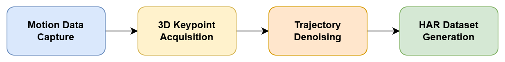
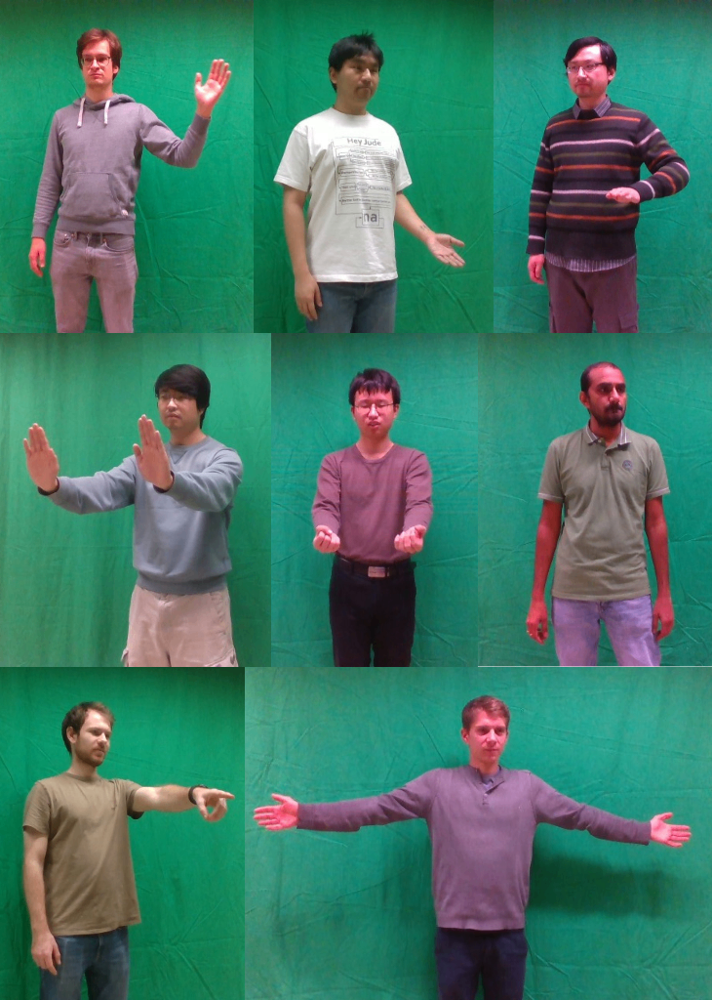
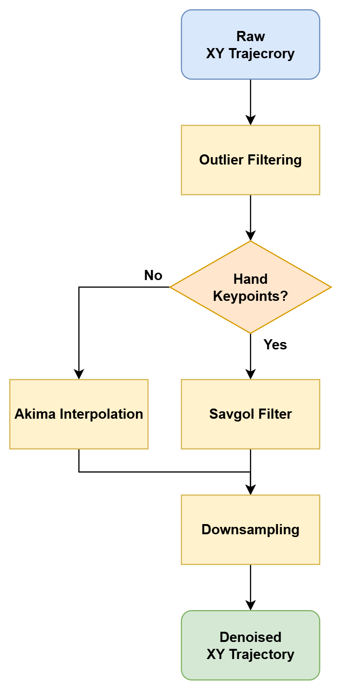
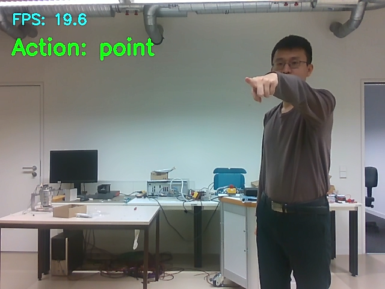

# 基于 RGB-D 骨骼的人员动作识别

[English](README.md) | [简体中文](README.zh-CN.md)

> 一个面向人机交互场景的轻量级 RGB-D 无标记 3D 骨骼动作识别与实时推理流程。

## 项目概述

本项目探索如何使用低成本 RGB-D 相机，构建面向人机交互场景的 3D 人体动作识别数据集。

完整流程包括 RGB-D 数据采集、人体姿态估计、2D 到 3D 关键点提升、轨迹去噪、滑动窗口数据集生成，以及基于骨骼的动作识别。

## 方法流程

1. 使用 Intel RealSense D435 RGB-D 相机采集动作数据
2. 将 2D 人体姿态估计结果与深度信息结合，获取 3D 关键点
3. 针对 XY 和 Z 方向的不同噪声特征，分别进行轨迹去噪
4. 使用固定长度滑动窗口生成动作片段
5. 使用 PoseFormer 和 ST-GCN 进行模型训练与评估
6. 在不同视角、光照、距离和局部遮挡条件下进行实时推理

## 数据采集

- 9 名参与者
- 8 类动作和姿态
- 1,264 条动作序列
- 上半身骨骼表示
- 动作和姿态包括挥手、抬起、按压、推动、拉动、指向、停止和背景

## 方法要点

### RGB-D 三维骨骼获取

首先对 RGB 图像进行人体姿态估计，再结合 RGB-D 相机提供的深度值，将 2D 关键点提升为 3D 关键点轨迹。

### 分方向轨迹去噪

将 3D 轨迹拆分为 XY 和 Z 两部分，根据各自的噪声特征采用不同的处理策略。

### 滑动窗口生成数据集

使用 48 帧窗口和 16 帧步长，从去噪后的轨迹中生成定长动作片段。这样可以提高数据利用率，也能让模型从一个正在进行的动作中的任意时刻开始识别。

## 结果

- 8 类动作共生成约 3,000 个滑窗片段
- PoseFormer 宏平均 F1：**0.8987**
- ST-GCN 宏平均 F1：**0.8927**
- XY 方向手部轨迹稳定性提升：速度最高 **29.7%**，加速度最高 **53.3%**
- Z 方向轨迹稳定性平均提升：速度 **58.5%**，加速度 **65.2%**

## 实时推理

基于骨骼的表示在侧视角、低光照、较远距离和部分关键点遮挡条件下仍能完成动作识别。

## 局限与后续工作

当前方法受到深度传感误差、遮挡、动作类别数量有限和参与者数量较少等因素的限制。后续工作包括多视角重建、更完善的去噪方法，以及规模更大、更多样化的数据集。

## 项目材料

- [研究报告](#)
- [答辩 slides](#)
- [源代码](#)

## 引用

如果使用本项目的材料，请引用配套研究报告。
